# Event-Driven Backtesting Framework

An educational, event-driven backtesting engine in Python. Signal timing and execution
timing are explicit, the accounting can be audited, and the cost model is itemised.
It includes walk-forward parameter selection, a protected final hold-out, a trial log
and Deflated Sharpe Ratio diagnostics. Two documented example strategies (SMA crossover
and 12-1 cross-sectional momentum) and a buy-and-hold validation show how it works.

> **Educational research software.** It is not production-ready, it does not connect to
> any broker, and no result here shows that a strategy is profitable. The headline
> results use **synthetic data**. They show that the software behaves correctly, not
> that any market edge exists.

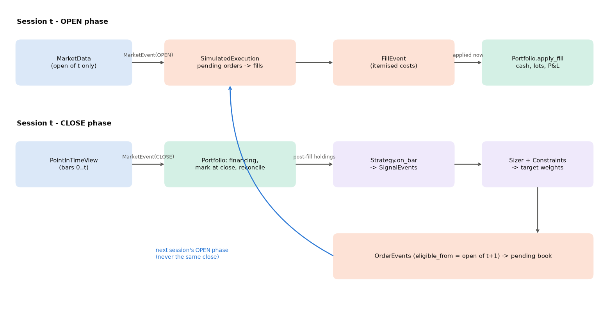

## Status: implemented vs unfinished

| Area | Status |
|---|---|
| Frozen events (`Market/Signal/Order/Fill/OrderStatus`), two-phase (OPEN/CLOSE) event loop | Implemented, tested |
| Point-in-time data view, OHLCV validation, missing/stale bars, lagged ADV/volatility | Implemented, tested |
| Point-in-time membership (`known_from`), universe-exit liquidation | Implemented, tested |
| Portfolio accounting: cash, FIFO lots, realised/unrealised P&L, shorts, reversals, reconciliation at every close | Implemented, tested |
| Next-open execution, gap resizing/rejection, expiry, replacement, participation cap, terminal liquidation | Implemented, tested |
| Costs: commission (min/max), half-spread, deterministic/stochastic slippage, √-impact, borrow fees, credit/debit interest | Implemented, tested (hand calculations) |
| Sizing: equal weight, fixed fraction, volatility target, capped fractional Kelly; gross/net/concentration limits | Implemented, tested |
| Strategies: buy-and-hold, SMA crossover, 12-1 momentum (long-only and long-short), equal-weight universe benchmark | Implemented, tested |
| Metrics, tearsheet, Sharpe SEs, block bootstrap | Implemented, tested |
| Walk-forward, trial log/registry, protected hold-out (lock, `--confirm`, evaluation log) | Implemented, tested |
| Deflated Sharpe Ratio (checked against the paper's numerical example) | Implemented, tested |
| Optional yfinance market-data cache | Implemented; executed once (see provenance); offline-tested with a fake provider |
| Research mode (150-asset universe, larger grids; outputs in `results/research/`) | Implemented; only the SMA and momentum demo steps were executed (momentum on 150 assets: Sharpe 0.32 vs 0.05 for its benchmark, synthetic). The research walk-forward (378 momentum trials on 150 assets, estimated at 2–3 hours on the development laptop) was **not run** |
| Vectorised fast mode, CPCV/PBO, intraday bars/limit orders, futures/FX, live trading | **Not implemented** |
| Autocorrelation-adjusted (Lo-style) Sharpe annualisation | **Not implemented** (block bootstrap provided instead) |

## Installation

Python 3.11 or later. From the project folder:

```powershell
python -m venv .venv
```
```powershell
.\.venv\Scripts\Activate.ps1
```
```powershell
python -m pip install -e ".[dev]"
```

(macOS/Linux: `source .venv/bin/activate`.) Use `".[dev,market]"` to add the optional
yfinance downloader. `requirements.txt` lists the same dependencies.

## Quick start (offline)

```powershell
python scripts/run_all.py
```

This generates the synthetic datasets if they are missing and runs every demonstration
experiment. It writes figures to `results/figures/`, tables to `results/tables/`, audit
logs to `results/logs/` and `results/run_metadata.json`. It **never** evaluates the
hold-out. On the development machine the full fast run took about 2.7 minutes.

## Commands

| Purpose | Command |
|---|---|
| Generate synthetic data | `python scripts/generate_synthetic_data.py` (`--research` adds the 150-asset universe) |
| Buy-and-hold validation | `python scripts/run_buy_and_hold.py` |
| SMA crossover demo | `python scripts/run_sma.py` |
| 12-1 momentum demo | `python scripts/run_momentum.py` |
| Walk-forward (SMA + momentum) | `python scripts/run_walkforward.py` |
| Cost sensitivity + robustness | `python scripts/run_cost_sensitivity.py` |
| Everything (fast mode) | `python scripts/run_all.py` |
| Research mode (slower; writes to `results/research/`) | `python scripts/run_all.py --research` |
| Optional market data (needs network) | `python scripts/download_market_data.py`, then `backtester demo sma_market --prefix 07_market_sma` |
| **Protected hold-out**: preview only | `python scripts/run_holdout.py --dry-run` |
| **Protected hold-out**: evaluate (logged and numbered) | `python scripts/run_holdout.py --confirm` |
| Fast tests | `python -m pytest -m "not slow"` |
| All tests + coverage | `python -m pytest --cov=backtester` |
| Lint / types | `python -m ruff check src tests scripts` and `python -m mypy` |

CLI equivalent: `backtester [--research] {generate-data | run-all [--only STEP ...] | demo CONFIG | holdout [--dry-run | --confirm]}`.

## Results from the executed runs

All tables below were produced by `python scripts/run_all.py` on **SYNTHETIC data**,
except the last section (market data). The protected hold-out (2022-01-01 to
2024-12-31) is excluded from every number. Execution: signal at close *t*, fill at the
next tradable open. Sharpe and Sortino use a 2% risk-free series accrued the same way as
cash. rf = 0 for the market sample and for walk-forward training objectives.

### Buy-and-hold validation
The engine's equity matched an independent pandas reference with the same timing
(decision close, next-open fill, residual cash) to **0.0 currency units** over 4,435
sessions. The guide's `cash·close/close[0]` formula differs by up to 6,637, because it
assumes a fill at the first close.

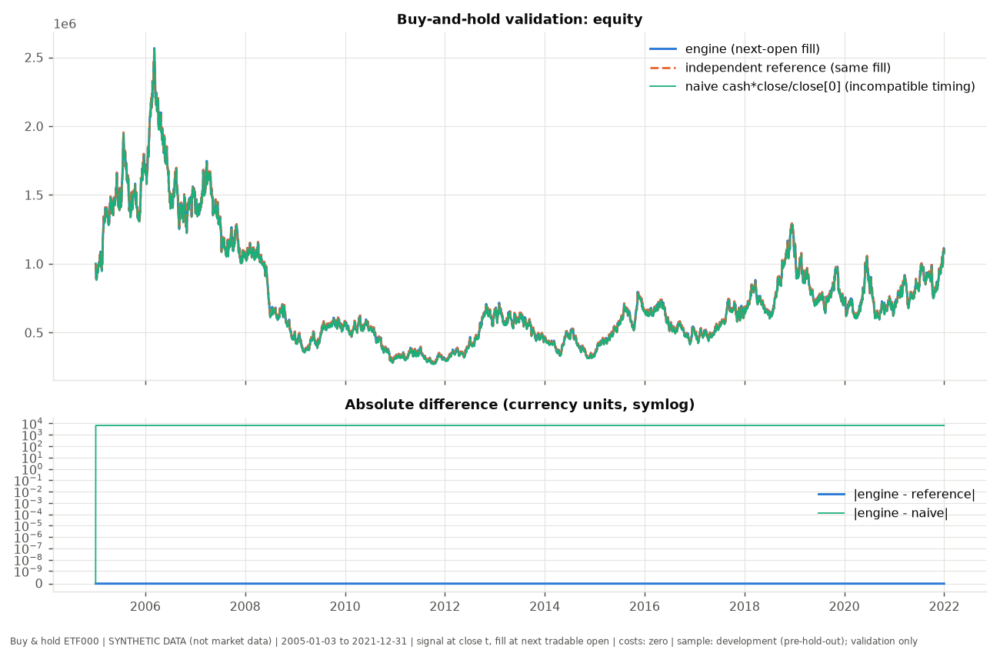

### Fixed-parameter demos (development sample, a-priori parameters, not out-of-sample)

| | SMA 50/200 (6 ETF-like assets) | Equal-weight benchmark | 12-1 momentum, top decile (40-stock universe) | Equal-weight point-in-time benchmark |
|---|---|---|---|---|
| Scored period | 2005-01-04 to 2021-12-31 | same | 2005-12-22 to 2021-12-31 | same |
| CAGR | 3.2% | 3.5% | 5.3% | −0.2% |
| Sharpe (rf 2%) | 0.16 | 0.18 | 0.26 | −0.07 |
| Sharpe 95% block-bootstrap CI | [−0.31, 0.63] | | [−0.22, 0.72] | |
| Max drawdown | 54.6% | 51.5% | 47.3% | 32.4% |
| One-way turnover per year | 2.29× | 0.19× | 4.13× | 1.36× |
| Trading costs (on 1,000,000) | 82,185 | 6,573 | 206,066 | 100,484 |
| Completed round trips / hit rate | 443 / 53% | | 757 / 60% | |

SMA 50/200 did **not** beat its benchmark on this sample. Momentum's higher Sharpe has a
confidence interval that includes zero.

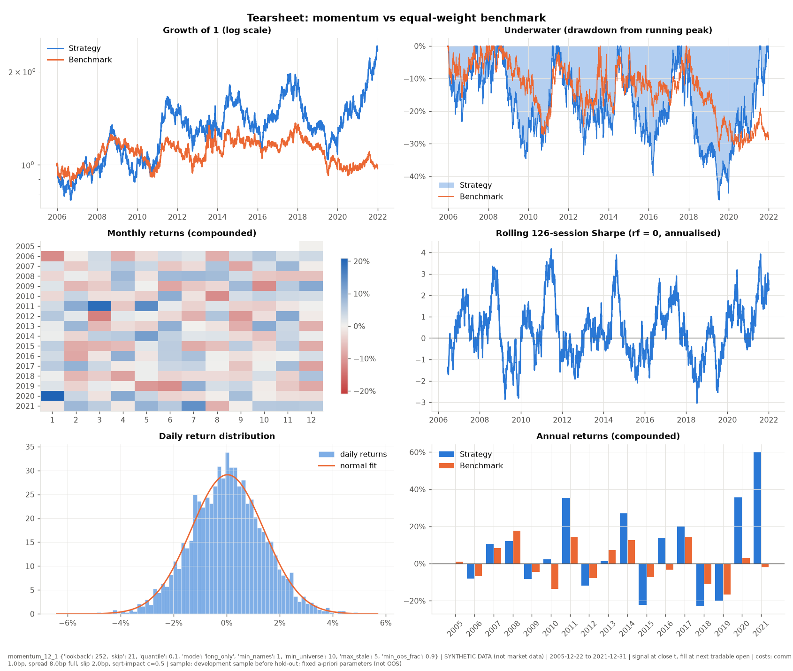

<details><summary>More SMA and momentum figures</summary>

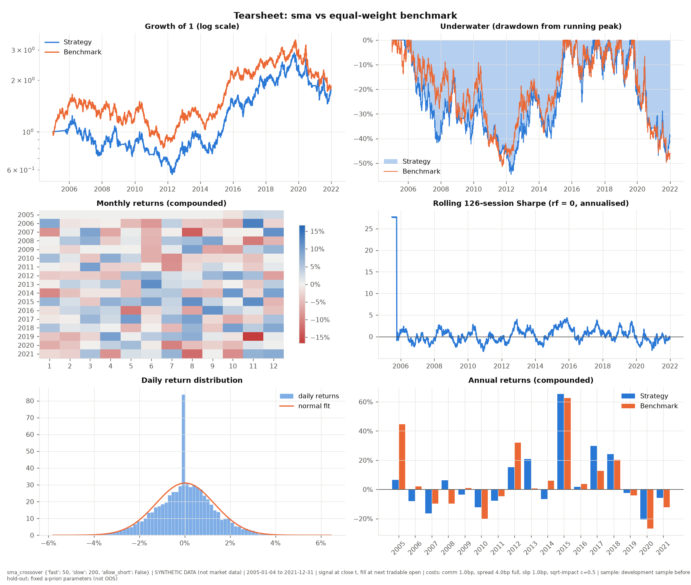
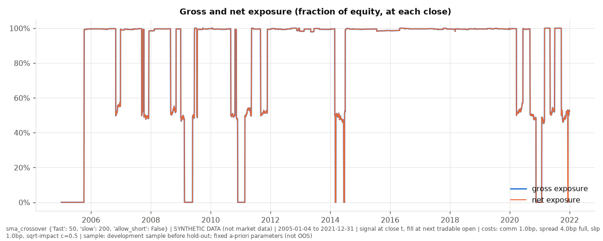
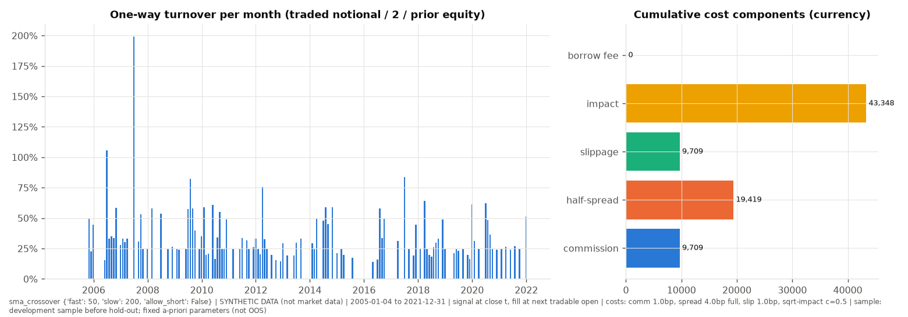
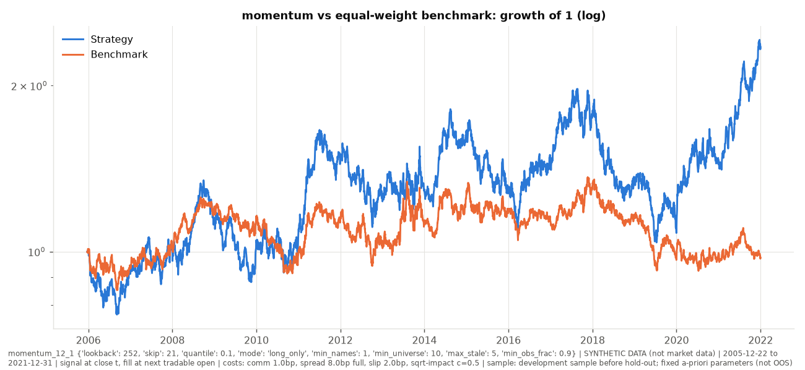
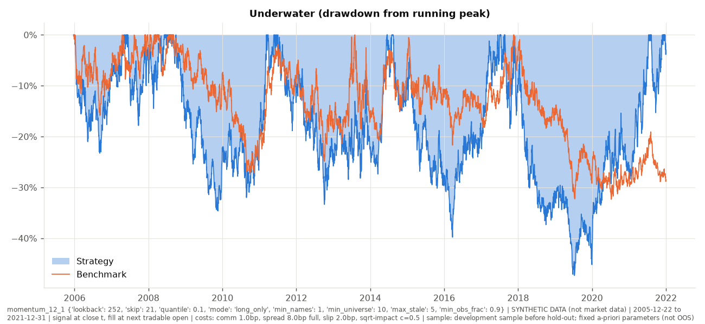
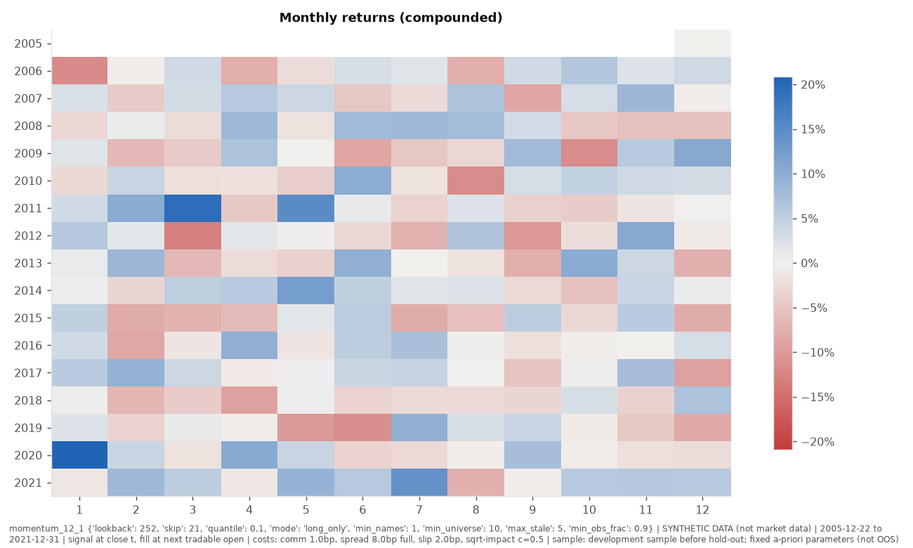
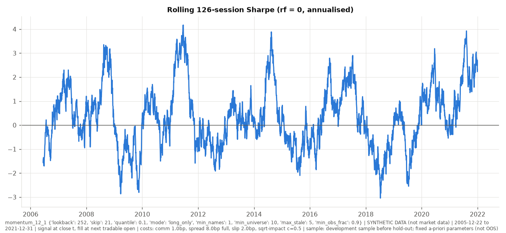
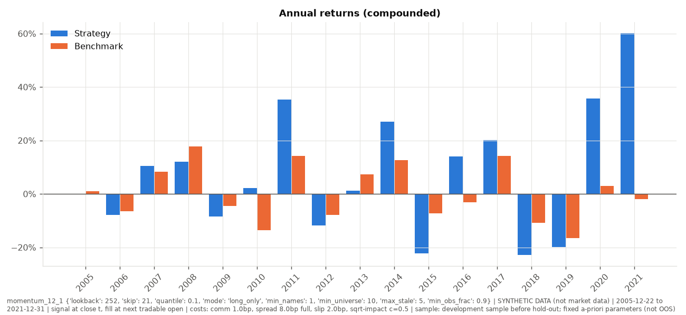
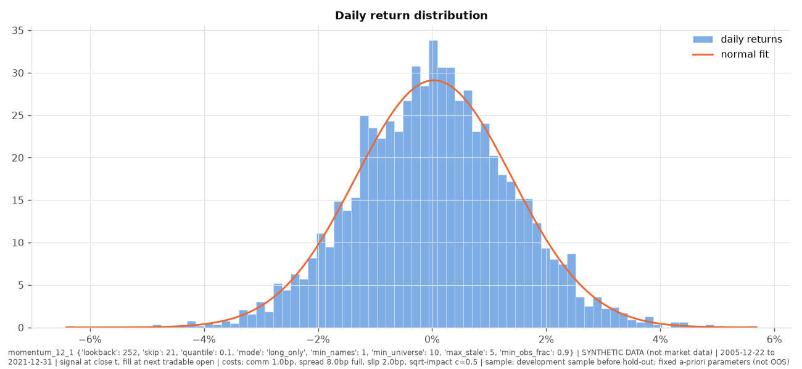
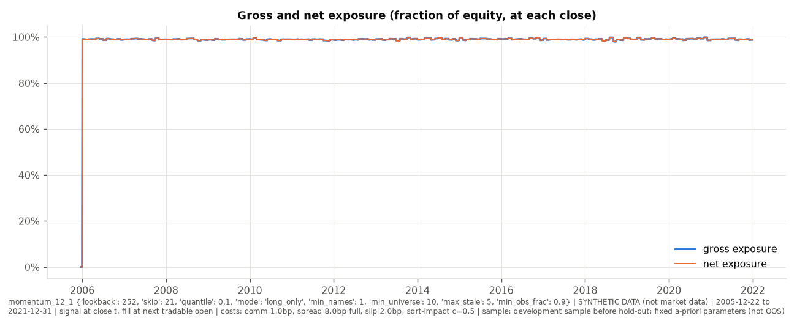
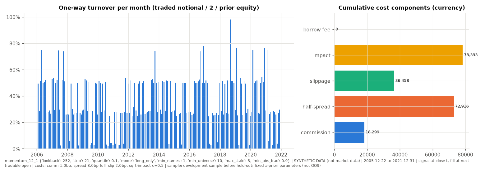
</details>

### Walk-forward (3-year train / 1-year test, 14 folds, stitched OOS 2008-01-03 to 2021-12-31)

| | SMA (16-point grid) | Benchmark | Momentum (8-point grid) | Benchmark |
|---|---|---|---|---|
| Trials logged | 224 (182 ok, 42 invalid `fast ≥ slow`) | | 112 (all ok) | |
| Stitched OOS CAGR | −2.1% | 2.1% | −0.7% | −0.2% |
| Stitched OOS Sharpe (rf 2%) | −0.11 | 0.10 | −0.02 | −0.07 |
| Max drawdown | 58.6% | 49.7% | 58.2% | 32.3% |
| Per-fold DSR of the training winner (raw N) | 0.15 to 0.97 | | 0.20 to 0.76 | |
| DSR of stitched OOS vs all trials (conservative diagnostic) | 0.000 | | 0.001 | |

**Negative finding:** for both strategies, re-selecting parameters every year did worse
out of sample than the fixed a-priori parameters on the same synthetic data. Training
winners often did not persist (see the per-fold summary). The training heatmap shows
only modest differences across the grid. After accounting for the search, no
configuration is statistically distinguishable from luck.

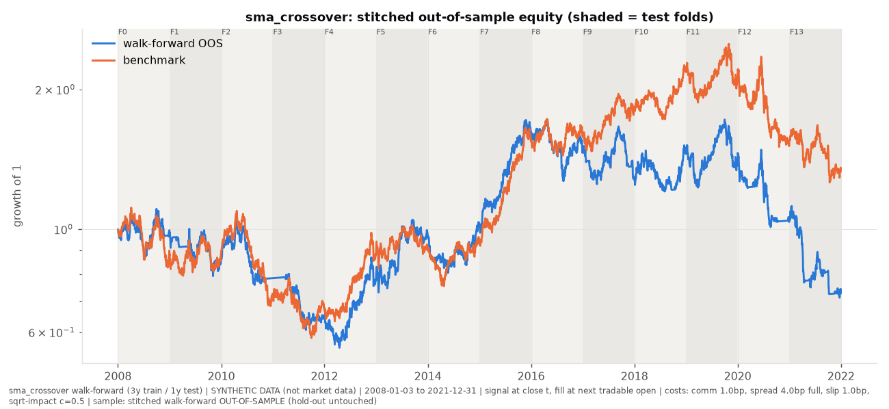
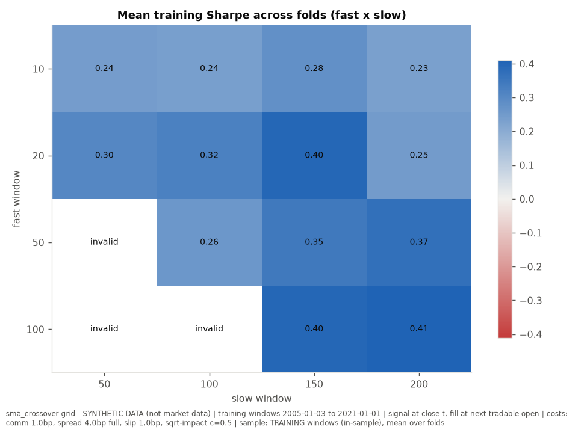
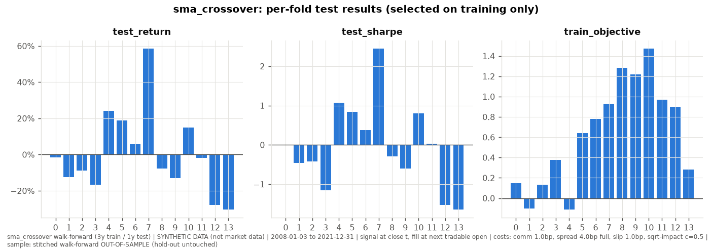

`results/figures/05_sma_wf_param_heatmap_EXPLORATORY_outer_test.png` shows every grid
point over the outer-test period. It is labelled **exploratory**, was not used for
selection, and must not be used to retune. Momentum walk-forward figures are prefixed
`06_`. Trial logs are in `results/tables/*_trial_log.csv` and DSR tables in
`results/tables/*_deflated_sharpe.csv`.

### Cost sensitivity (a flat one-way cost **replaces** the detailed model; parameters and dates fixed)

| One-way cost | SMA CAGR | SMA Sharpe | SMA MaxDD | Momentum CAGR | Momentum Sharpe | Momentum MaxDD |
|---|---|---|---|---|---|---|
| 0 bps | 3.7% | 0.19 | 53.2% | 6.3% | 0.30 | 46.2% |
| 5 bps | 3.4% | 0.17 | 54.1% | 5.8% | 0.28 | 46.7% |
| 10 bps | 3.2% | 0.16 | 55.0% | 5.4% | 0.26 | 47.2% |
| 20 bps | 2.7% | 0.14 | 56.8% | 4.5% | 0.22 | 48.2% |
| 50 bps | 1.2% | 0.07 | 61.7% | 1.9% | 0.11 | 53.1% |

Turnover is about 2.4×/yr (SMA) and 4.1×/yr (momentum). Per-scenario turnover, trading
costs and financing are in `results/tables/cost_sensitivity.csv`.

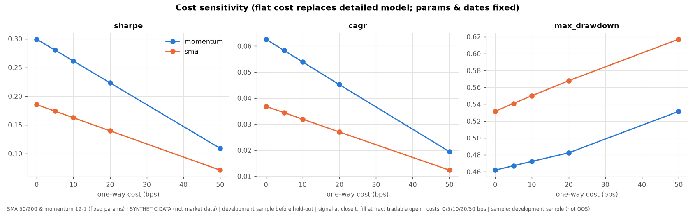

### Robustness (SMA 50/200, development sample; `results/tables/robustness_sma*.csv`)

| Check | Result |
|---|---|
| Execution delay 1 / 2 / 3 sessions | Sharpe 0.17 / 0.14 / 0.11 |
| Leverage cap 0.5 / 1.0 / 1.5 (fixed fraction 0.5 per asset) | Sharpe 0.24 / 0.17 / 0.16; max drawdown 29% / 55% / 71% |
| Sizing: equal weight / vol target 10% / capped ½-Kelly | Sharpe 0.17 / 0.29 / 0.33, at average gross exposure 0.87 / 0.34 / 0.33 |
| Walk-forward train window 2 / 3 / 4 years (common OOS dates 2009–2021, rf 0) | Sharpe 0.18 / −0.01 / 0.13 |

The vol-target and Kelly rows mostly improve risk-adjusted numbers by holding less
risk. That is one synthetic sample, not a general result. Results are sensitive to the
training-window length, so no single configuration deserves much weight.

### Optional market-data run (real data, not point-in-time)

Ten US sector and broad-market ETFs from Yahoo Finance (`auto_adjust=True`, retrieved
2026-11-22). SMA 50/200 with detailed costs, development sample 2005-01-04 to 2021-12-31
(hold-out excluded), rf = 0:

| | SMA 50/200 | Equal-weight ETFs |
|---|---|---|
| CAGR | 10.1% | 10.2% |
| Sharpe | 0.71 | 0.62 |
| Max drawdown | 33.6% | 52.0% |
| Turnover per year | 1.93× | 0.05× |

The ETF list was chosen today, so the sample carries selection/survivorship bias, and
adjusted prices are an approximation. Figures: `results/figures/07_market_sma_*.png`.

## Bias safeguards

| Safeguard | Where tested |
|---|---|
| Next-open fills, never at the signal close | `test_fill_at_next_open_never_same_close` |
| No close/high/low/volume visible at the open | `test_open_phase_view_hides_current_close` |
| Future-spike test | `test_future_spike_cannot_be_traded_early` |
| Future shuffle/scale invariance | `test_future_data_mutation_does_not_change_past` |
| Fills applied before new decisions | `test_strategy_sees_post_fill_holdings` |
| Lagged ADV/volatility for impact | `test_lagged_estimates_ignore_same_day_volume` |
| No trading at forward-filled prices | `test_missing_bar_order_waits_and_is_not_filled_at_ffilled_price` |
| Point-in-time membership | `test_membership_known_from_and_end`, `test_momentum_respects_point_in_time_membership` |
| Coherent multi-asset allocation | `test_multi_asset_targets_are_one_coherent_rebalance` |
| Costs charged once and reconciled | `test_execution_itemised_costs_reconcile`, `test_reconciliation_table_closes` |
| Timing-consistent buy-and-hold reference | `test_buy_and_hold.py` |
| Training-only selection, disjoint folds, continuous OOS | `test_walkforward.py` |
| Hold-out excluded, locked, confirmation required, logged | `test_holdout_*`, `test_integration_experiments.py` |
| Every trial logged; DSR matches the paper's numbers | `test_trial_log_records_every_configuration`, `test_dsr_reproduces_bailey_lopez_de_prado_2014_example` |

Full table: [docs/bias_controls.md](docs/bias_controls.md).

## Write your own strategy

```python
from backtester import Backtest, MarketData, Strategy

class Breakout(Strategy):
    name = "breakout_20"

    def on_bar(self, event):
        sigs = []
        for s in self.view.universe():                      # point-in-time members
            px = self.view.history(s, "close", n=21)        # observed closes up to t
            up = len(px) == 21 and px[-1] > px[:-1].max()
            sigs.append(self.signal(event, s, 1.0 if up else 0.0))
        return sigs                                          # complete target view

data = MarketData.from_csv("data/synthetic/etf_like.csv").slice(end="2021-12-31")  # keep hold-out out
result = Backtest(data, Breakout()).run()                   # fills at next open
print(result.returns().tail(), result.cost_summary())
```

Pass a sizer (`VolTarget(...)`), constraints (`PortfolioConstraints(...)`), costs
(`CostModel(...)`), financing, a `MembershipUniverse` or a `BacktestConfig` to the
`Backtest` constructor. Return `None` from `on_bar` to keep the current targets.

## Data provenance

* **Synthetic** (`data/synthetic/`, generated by `backtester.synthetic`, seeds 101, 202
  and 303): a regime-switching market factor, betas, idiosyncratic noise and a slow
  mean-reverting asset drift (a disclosed assumption that may favour trend rules).
  The data include late listings, delistings (half of them preceded by crashes) and
  short halts, on a business-day calendar. Specs are in each `.meta.json` and in
  `results/run_metadata.json`.
* **Market** (`data/market/us_sector_etfs.csv`, optional): Yahoo Finance via yfinance
  1.8.0. Symbols SPY, XLB, XLE, XLF, XLI, XLK, XLP, XLU, XLV, XLY, all in USD. Requested
  period 2005-01-01 to 2025-01-01, 50,330 rows. 90 rows with rounding-size OHLC
  inconsistencies were repaired and 0 were dropped. Provenance is in `.meta.json`. The
  file is for personal research; check Yahoo's terms before redistributing it.
* Package versions, configs, seeds and runtimes: `results/run_metadata.json`.

## Assumptions and limitations

* Prices use the adjusted-price approximation; there are no discrete corporate actions.
* Fills happen only at the open.
* Liquidity is unlimited unless `max_participation` is set.
* Cost, impact and borrow parameters are uncalibrated assumptions.
* Every short is assumed borrowable.
* Delisted holdings keep a stale last price, which can overstate returns.
* Single currency only, with a constant risk-free rate.
* √252 annualisation assumes IID returns.
* DSR relies on approximate formulas and cannot count research done outside the framework.

See [docs/limitations.md](docs/limitations.md), which also lists what live trading would
additionally require.

## Documentation

| Document | Contents |
|---|---|
| [architecture.md](docs/architecture.md) | Event loop, components, corrections to the guide's loop, the gap to live trading |
| [methodology.md](docs/methodology.md) | Plain-English explanations (timing, costs, Sharpe vs Sortino, walk-forward, DSR, survivorship) |
| [execution_and_accounting.md](docs/execution_and_accounting.md) | Exact timing, cash, costs, financing, lots, marks |
| [bias_controls.md](docs/bias_controls.md) | Each bias, its safeguard and its test |
| [statistical_validation.md](docs/statistical_validation.md) | Verified formulas and **20 corrections to the build guide** |
| [data_dictionary.md](docs/data_dictionary.md) | Inputs and every output file |
| [limitations.md](docs/limitations.md) | Unresolved biases and unfinished extensions |
| [interview_notes.md](docs/interview_notes.md) | Answers to the guide's interview questions |

The notebooks in `notebooks/` (`01_sma_demo`, `02_momentum_walkforward`,
`03_cost_sensitivity`) have been executed. They are thin and call package functions.

## Disclaimer

For education and research only. Not investment advice. Past or simulated performance
does not guarantee future results.
