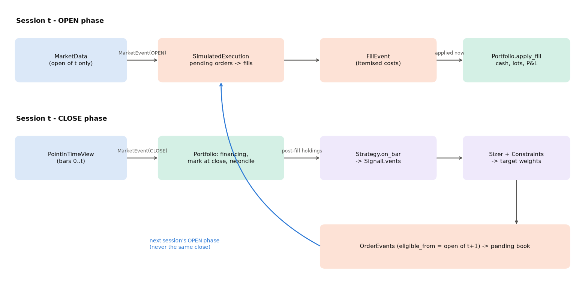

# Architecture



## What "event-driven" means here

The engine walks through history one trading session at a time. Each session has
two moments, and every component reacts only to information available at that moment:

1. **OPEN**: only the opening price of the session is known. Orders created at an
   earlier close are filled now, and the fills are applied to cash and positions
   immediately.
2. **CLOSE**: the whole bar (open, high, low, close, volume) is known. The portfolio is
   marked at the close, interest and borrow fees accrue, and the strategy looks at the
   completed bar and may emit signals. Orders created now can fill **no earlier than the
   next session's open**.

A vectorised backtest computes everything on whole columns at once. It is fast, but one
misplaced `shift()` can leak the future. In the event loop the strategy can only ask
the `PointInTimeView` for data that exists at the current (session, phase).

## Components (dependency injection)

| Module | Responsibility |
|---|---|
| `events.py` | Frozen `MarketEvent`, `SignalEvent`, `OrderEvent`, `FillEvent`, `OrderStatusEvent`; `Phase`, `OrderStatus` |
| `data.py` | `MarketData` (validated OHLCV panel, lagged ADV/vol estimates), `PointInTimeView` (the strategy-facing interface) |
| `universe.py` | `StaticUniverse`, `MembershipUniverse` (dated intervals with `known_from`) |
| `strategy.py` | `Strategy` ABC: `on_bar(event) -> list[SignalEvent] or None` |
| `sizing.py` | `EqualWeight`, `FixedFraction`, `VolTarget`, `KellyCapped`; `PortfolioConstraints` |
| `costs.py` | `Commission`, `SpreadCost`, `Slippage`, `SqrtImpact`, `CostModel`, `FinancingModel` |
| `execution.py` | `SimulatedExecution`: pending-order book, next-open fills, resizing, expiry |
| `portfolio.py` | Cash, positions, FIFO lots, realised/unrealised P&L, reconciliation |
| `engine.py` | `Backtest`: the phase-aware FIFO event loop |
| `results.py` | `BacktestResult`: equity, fills, orders, status log, round trips, reconciliation, persistence |
| `performance.py` / `statistics.py` | Metrics; Sharpe SEs, bootstrap, PSR/DSR, effective trials |
| `walkforward.py` | Folds, trial log, `ScheduledStrategy`, hold-out guard/lock/evaluation |
| `plots.py` | PNG figures with a provenance footer |
| `experiments.py` / `cli.py` | Reproducible demonstration experiments; `backtester` CLI |
| `synthetic.py` / `market.py` | Synthetic generator; optional yfinance cache |

Strategies, sizers, cost models, execution settings, financing and the universe are all
constructor arguments of `Backtest`, so each can be replaced without touching the
others.

## The loop in detail

```
for each session t:
    view -> (t, OPEN)
    queue <- MarketEvent(t, OPEN)
    drain:  MarketEvent(OPEN) -> execution.execute_open(t)     # fills applied immediately
            FillEvent          -> audit log
    view -> (t, CLOSE)
    accrue financing (balances at previous close, calendar days elapsed)
    mark positions at close of t (stale last close if no bar), reconcile, snapshot
    queue <- MarketEvent(t, CLOSE)
    drain:  MarketEvent(CLOSE) -> strategy.on_bar -> SignalEvents
                               -> sizer + constraints -> target weights
                               -> OrderEvents (eligible_from = session t+1 open)
            OrderEvent         -> execution.submit (replaces any pending order, same symbol)
```

### Corrections to the guide's sample loop

The guide's sample loop processes, for one `MarketEvent`: mark-to-market, then
`execution.fill_pending(ev)`, then `strategy.on_bar(ev)`, with fills appended to the
FIFO queue *behind* the new signals. That ordering has three problems, fixed here:

1. Fills generated by `fill_pending` sit in the queue while the strategy and portfolio
   create new orders, so new orders are sized from **stale holdings**.
2. A single bar event is used both to fill orders and to run the strategy, so it is
   ambiguous whether fills use the open or the close of that bar, and whether the
   strategy has already seen the close used for filling.
3. Marking happens before the day's fills are applied.

Here each session has explicit OPEN and CLOSE phases, fills are applied at the open
before anything else, and the strategy only runs at the close on post-fill holdings.

## Writing a new strategy

```python
from backtester import Backtest, Strategy
from backtester.events import MarketEvent, SignalEvent

class Breakout(Strategy):
    name = "breakout_20"

    def on_bar(self, event: MarketEvent) -> list[SignalEvent] | None:
        out = []
        for s in self.view.universe():                     # point-in-time members
            px = self.view.history(s, "close", n=21)       # observed closes up to t
            if len(px) < 21:
                out.append(self.signal(event, s, 0.0))     # not enough history
                continue
            out.append(self.signal(event, s, 1.0 if px[-1] > px[:-1].max() else 0.0))
        return out                                          # complete target view

result = Backtest(data, Breakout()).run()                  # fills at next open
```

Return `None` to keep current targets (no orders). A returned list is a complete target
portfolio: held symbols that are not mentioned are targeted to zero.

## From backtest to live trading

Replacing the data handler is **not** sufficient. A live system additionally needs a
broker execution adapter, order-state reconciliation against the broker, partial-fill and
reject handling, corporate-action and calendar feeds, position and cash reconciliation,
risk limits enforced before submission, monitoring and alerting, restart/recovery with
persisted state, clock and timezone management, and a kill switch. None of that is
implemented here; this package is research software.
